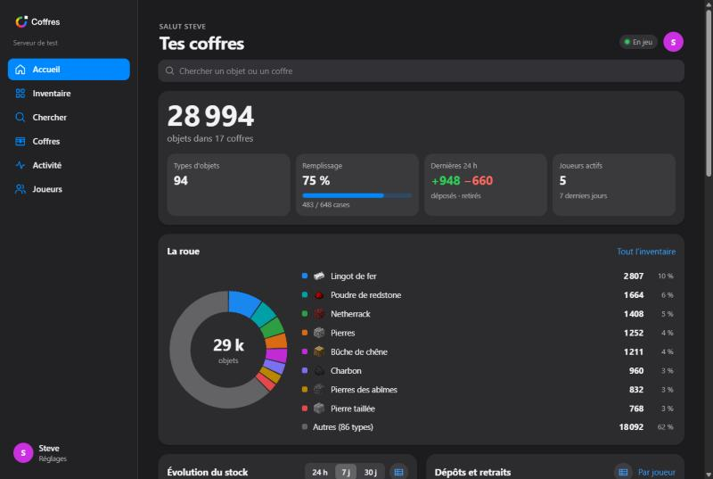
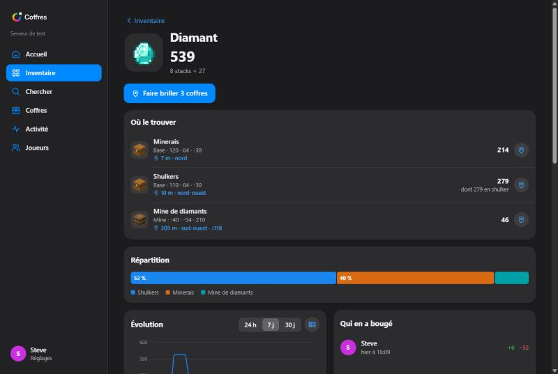
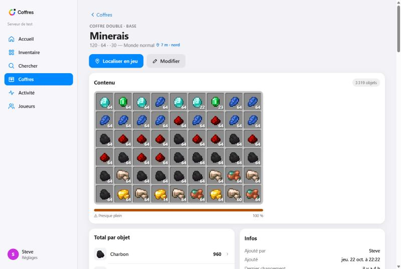
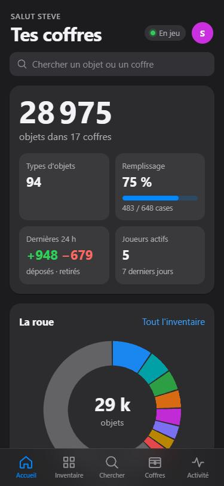
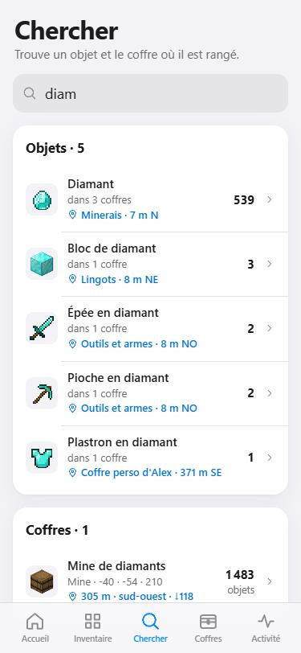
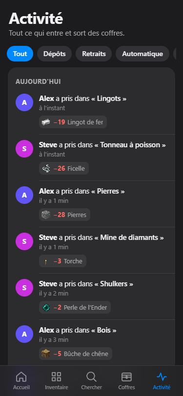

<p align="center">
  <picture>
    <source media="(prefers-color-scheme: dark)" srcset="branding/logo/coffres-horizontal-couleur-sur-sombre.svg">
    
  </picture>
</p>

<p align="center">
  <b>Tout ce qu'il y a dans tes coffres, partout.</b><br>
  Plugin Minecraft Paper qui compte le contenu des coffres du serveur<br>
  et l'affiche sur un site pour téléphone et PC, installable sur l'iPhone comme une appli.
</p>

<p align="center">
  
  
  
  
</p>

<p align="center">
  
</p>

---

## Sommaire

- [Ce que fait Coffres](#ce-que-fait-coffres)
- [Projets de construction](#projets-de-construction)
- [Captures d'écran](#captures-décran)
- [Installation](#installation)
- [Se connecter au site](#se-connecter-au-site)
- [Commandes et permissions](#commandes-et-permissions)
- [Qui voit quoi](#qui-voit-quoi)
- [Configuration](#configuration)
- [Comment ça marche](#comment-ça-marche)
- [Dépannage](#dépannage)
- [Pour les développeurs](#pour-les-développeurs)

---

## Ce que fait Coffres

### En jeu
- **`/coffres`** ouvre un menu. Active le **mode ajout**, puis fais un **clic droit** sur tes coffres, tonneaux
  ou boîtes de Shulker : ils sont comptés, et ils sont **privés** (toi seul les vois). Reclique sur un coffre pour le retirer.
- **Chaque dépôt et chaque retrait est enregistré** avec le nom du joueur.
- Les **entonnoirs, golems de cuivre et autres machines** sont détectés et notés « automatique ».
- Un coffre **cassé** ou **détruit par une explosion** est noté dans l'historique.
- Le contenu des **boîtes de Shulker et des sacs** rangés dans les coffres est compté aussi.
- **`/coffres chercher diamant`** te dit où sont tes diamants et **fait briller les coffres**.
- **`/coffres projet`** montre tes **projets de construction** et les blocs qu'il manque ;
  **`/coffres projet lier <nom>`** puis un clic droit lie des coffres à un projet.

### Sur le site
Le site a deux parties, qu'on choisit en haut des pages : **Mes coffres** (seulement ceux que tu as ajoutés) et
**Communs** (ceux que leurs propriétaires ont partagés avec tout le serveur). Les deux ne sont jamais mélangés.

| Page | Ce qu'on y trouve |
|---|---|
| **Accueil** | Total des objets, **la roue** de tous les objets, évolution du stock (24 h / 7 j / 30 j), dépôts et retraits par jour, joueurs les plus actifs, zones, activité récente |
| **Inventaire** | Tous les objets avec leurs **vraies icônes Minecraft** et leurs **noms en français** |
| **Chercher** | Tape « diam » : tu vois dans quels coffres c'est rangé et **lequel est le plus proche de toi** (« 7 m nord ») |
| **Objet** | Où le trouver, répartition entre les coffres, évolution, qui en a déposé ou pris |
| **Projets** | Envoie un fichier **Litematica** ou **schematic** : tous les blocs qu'il faut, le **pourcentage** déjà réuni dans les coffres liés, ce qu'il manque |
| **Coffres** | Rangés par zone (Base, Ferme, Mine…), avec leur remplissage |
| **Coffre** | Ses cases **comme dans le jeu** (on peut ouvrir une shulker), son historique, renommer, **rendre commun** ou privé |
| **Activité** | Tout l'historique, filtrable : dépôts, retraits, automatique, par joueur, par objet |
| **Joueurs** | Qui dépose et qui prend, sur 7 ou 30 jours, et qui est en ligne |

Et partout : bouton **« Localiser en jeu »** qui fait **briller le coffre en bleu à travers les murs**, avec
un faisceau lumineux et une flèche dans la barre d'action qui te guide jusqu'à lui. Il s'éteint dès que tu l'ouvres.

Thème clair / sombre automatique, mise à jour en direct toutes les 5 secondes, chaque graphique peut aussi
s'afficher en tableau.

---

## Projets de construction

Tu prépares un château, une ferme, une base ? Envoie son plan sur le site et Coffres fait la liste de courses.

1. Sur le site, onglet **Projets** → **Nouveau projet**, puis choisis (ou glisse) ton fichier.
2. Donne-lui un nom et choisis **Commun** (tout le serveur le voit et peut y lier ses coffres) ou **Solo** (toi seul).
3. Coffres compte **tous les blocs qu'il faut** : un graphique des matériaux, le total, l'équivalent en stacks et en shulkers.
4. **Lie les coffres** où tu ranges les matériaux (sur le site en cochant, ou en jeu avec `/coffres projet lier <nom>`
   puis un clic droit sur les coffres). Leur contenu est compté en direct, shulkers comprises.
5. Tu vois le **pourcentage réuni**, bloc par bloc ce qu'il **manque** (« 520 · 8 stacks + 8 ») et ce qui traîne
   **ailleurs** dans d'autres coffres. Un bouton copie la liste des manquants pour la coller sur Discord.

| Fichier | Programme | Notes |
|---|---|---|
| `.litematic` | Litematica | Toutes les versions, toutes les régions |
| `.schem` | WorldEdit 7+, FAWE, Sponge | Versions 1, 2 et 3 du format |
| `.schematic` | MCEdit, ancien WorldEdit (≤ 1.12) | Les numéros de blocs sont traduits en blocs actuels |
| `.nbt` | Blocs de structure, Create | |

**Ce qui est compté :** ce qu'il faut *poser*. Une porte, un lit ou une grande fleur comptent une fois ; une dalle
double compte 2 dalles ; 3 bougies sur un bloc comptent 3 bougies ; une torche murale est une torche ; des carottes
plantées sont des carottes ; un pot de fleurs avec un coquelicot donne un pot + un coquelicot ; une source d'eau donne
un seau d'eau (l'eau qui coule est ignorée). L'air, les portails et le feu sont ignorés. Le contenu des coffres et les
entités (cadres, armures) dessinés dans le plan ne sont pas comptés.

Le fichier n'est pas gardé : seule la liste des blocs l'est (`projects.json`). Seuls les coffres que *tu* as le droit
de voir comptent pour toi : un coffre privé lié par quelqu'un d'autre n'affiche pas son contenu.

En jeu, `/coffres projet` ouvre la liste des projets avec une barre d'avancement ; dans un projet, chaque bloc indique
ce qu'il manque, et un clic fait briller les coffres qui en contiennent.

Pour essayer : [`docs/exemples/`](docs/exemples/) contient une petite maison en `.litematic` et en `.schem` (411 blocs).

---

## Captures d'écran

<table>
  <tr>
    <td width="50%"><br><sub>Un objet : où il est, à quelle distance, son évolution</sub></td>
    <td width="50%"><br><sub>Un coffre affiché comme en jeu (thème clair)</sub></td>
  </tr>
</table>

<table>
  <tr>
    <td width="33%"><br><sub>Accueil sur iPhone</sub></td>
    <td width="33%"><br><sub>Recherche avec le coffre le plus proche</sub></td>
    <td width="33%"><br><sub>Qui a pris quoi, et quand</sub></td>
  </tr>
</table>

<sub>Captures faites avec des données de démonstration (`./gradlew runDev`).</sub>

---

## Installation

**Prérequis :** un serveur **Paper 26.2** (ou plus récent) qui tourne avec **Java 25**.

1. Télécharge `Coffres-1.2.1.jar` (dans le dossier [`release/`](release/) ou dans l'onglet **Releases**).
2. Mets-le dans le dossier `plugins/` du serveur et démarre le serveur.
3. **Ouvre le port du site (8125 par défaut).** C'est un port en plus de celui de Minecraft :
   - serveur chez toi : redirige le port **TCP 8125** de ta box vers la machine du serveur ;
   - hébergeur : ajoute un **port supplémentaire** dans le panel, puis mets ce numéro dans `config.yml`.
4. Dans `plugins/Coffres/config.yml`, indique l'adresse que les joueurs taperont :
   ```yaml
   web:
     port: 8125
     public-url: "http://play.monserveur.fr:8125"
     server-name: "Mon serveur"
   ```
5. Tape `/coffres reload` (ou redémarre).

Au premier démarrage, le plugin télécharge **une seule fois** les textures et les noms d'objets officiels depuis les
serveurs de Mojang (comme le fait BlueMap). Rien n'est envoyé à Mojang. Pour l'empêcher :
`assets.download-from-mojang: false` (le site affichera alors des icônes simplifiées).

---

## Se connecter au site

Le site est le même pour tout le serveur : **chaque joueur se connecte avec son pseudo Minecraft.**

- **Le plus simple :** en jeu, tape **`/coffres web`**. Tu reçois un lien cliquable qui te connecte directement.
- **Depuis le site :** tape ton pseudo, un **code à 6 chiffres** apparaît dans ton chat en jeu, recopie-le.

La connexion dure 180 jours. **`/coffres deconnexion`** déconnecte tous tes appareils.

### Installer sur iPhone (icône sur l'écran d'accueil)

1. Ouvre le site dans **Safari**
2. Touche **Partager** (le carré avec la flèche)
3. Choisis **Sur l'écran d'accueil**, puis **Ajouter**

L'icône Coffres apparaît avec tes applis et s'ouvre en plein écran. Connecte-toi une fois dedans : l'appli de
l'écran d'accueil a sa propre session, séparée de Safari.

**Android :** Chrome → menu ⋮ → *Installer l'application*. **PC :** Chrome ou Edge → icône d'installation dans la barre d'adresse.

---

## Commandes et permissions

| Commande | Effet |
|---|---|
| `/coffres` | Menu : mode ajout, lien du site, liste des coffres, recherche |
| `/coffres ajouter` | Active / coupe le mode ajout (clic droit sur les coffres) |
| `/coffres web` | Lien + code de connexion au site |
| `/coffres chercher <objet>` | Où est cet objet ? Fait briller les coffres les plus proches |
| `/coffres liste` | Liste des coffres en menu (clic = le faire briller) |
| `/coffres projet` | Les projets de construction et leur avancement (menu) |
| `/coffres projet <nom>` | Les blocs qu'il manque pour ce projet (clic = faire briller les coffres qui en ont) |
| `/coffres projet lier <nom>` | Clic droit sur des coffres pour les lier au projet (ou les délier) |
| `/coffres nom <nom>` | Renomme le coffre que tu regardes (ou celui que tu viens d'ajouter) |
| `/coffres zone <zone>` | Range le coffre dans une zone. `/coffres zone -` pour l'enlever |
| `/coffres prive` | Remet en privé le coffre commun que tu regardes |
| `/coffres prive tout` | Remet tous tes coffres en privé d'un coup |
| `/coffres info` | Infos sur le coffre que tu regardes |
| `/coffres retirer` | Ne plus suivre le coffre que tu regardes |
| `/coffres deconnexion` | Te déconnecter du site sur tous tes appareils |
| `/coffres reload` | Recharger la configuration (admin) |

Alias : `/coffre`, `/stock`.

| Permission | Par défaut | Effet |
|---|---|---|
| `coffres.use` | tout le monde | Ajouter ses coffres, utiliser le site |
| `coffres.admin` | op | Voir et gérer tous les coffres, même privés ; `/coffres reload` |

---

## Qui voit quoi

- Un coffre est **toujours privé quand on l'ajoute** : seuls la personne qui l'a ajouté et les admins le voient
  (contenu, position, historique). Il n'y a pas d'option pour le rendre public en jeu, et aucun réglage ne le rend
  visible au départ : une base secrète reste secrète.
- Pour partager un coffre, son propriétaire ouvre sa page sur le site et clique sur **Rendre commun** (le site
  prévient que tout le serveur verra sa position). Il apparaît alors dans la partie **Communs** pour tout le monde.
  Seul celui qui a ajouté le coffre peut le rendre commun, même un admin ne peut pas exposer le coffre d'un autre.
- **Rendre privé** (site, ou `/coffres prive` en jeu) le cache de nouveau.
- Sur le site, **Mes coffres** ne montre que tes coffres, **Communs** que les coffres partagés. Les admins ont en
  plus une partie **Tous**.
- Seul celui qui a ajouté un coffre (ou un admin) peut le **renommer** ou le **retirer**.
- En passant de la version 1.x à la 1.2, **tous les coffres déjà suivis deviennent privés** (ils étaient publics par
  défaut avant). Chacun peut rendre communs ceux qu'il veut partager.
- Pour ajouter un coffre, il faut pouvoir l'ouvrir : les **protections de zone** (claims, régions) sont respectées.
- Un **projet commun** est visible par tous, et chacun peut y lier les coffres qu'il voit. Un **projet solo** n'est
  visible que par son créateur et les admins. Seul le créateur (ou un admin) peut renommer, remplacer le fichier ou
  supprimer un projet. Chaque joueur peut créer jusqu'à 15 projets (réglable).

---

## Configuration

Fichier `plugins/Coffres/config.yml` (créé au premier démarrage) :

| Clé | Défaut | Rôle |
|---|---|---|
| `web.enabled` | `true` | Active le site |
| `web.port` | `8125` | Port du site |
| `web.bind` | `0.0.0.0` | Adresse d'écoute. `127.0.0.1` si tu passes par un proxy |
| `web.public-url` | *(vide)* | Adresse du site utilisée dans les liens en jeu |
| `web.server-name` | `Mon serveur` | Nom affiché sur le site |
| `tracking.containers` | `*CHEST`, `BARREL`, `*SHULKER_BOX` | Blocs suivis (`*` = n'importe quel début) |
| `tracking.count-shulker-contents` | `true` | Compter le contenu des shulkers et sacs rangés dans les coffres |
| `tracking.chests-per-tick` | `10` | Coffres revérifiés par tick (détection des machines) |
| `tracking.link-mode-timeout-seconds` | `180` | Le mode ajout se coupe tout seul après ce délai |
| `tracking.auto-group-seconds` | `60` | Regroupement des mouvements automatiques dans l'historique |
| `history.retention-days` | `60` | Jours d'historique gardés |
| `history.max-entries` | `300000` | Lignes d'historique maximum en mémoire |
| `auth.session-days` | `180` | Durée d'une connexion au site |
| `locate.duration-seconds` | `60` | Durée de la surbrillance « Localiser en jeu » |
| `projects.max-file-mb` | `20` | Taille maximale d'un plan envoyé sur le site (Mo) |
| `projects.max-per-player` | `15` | Projets maximum par joueur (pas de limite pour les admins) |
| `assets.download-from-mojang` | `true` | Télécharger les vraies icônes et les noms d'objets |
| `assets.language` | `fr_fr` | Langue des noms d'objets (`en_us`, `de_de`, `es_es`…) |

### HTTPS (facultatif)

Place le site derrière **Caddy**, **Nginx** ou **Cloudflare Tunnel**, mets `web.bind: "127.0.0.1"` et
`web.public-url: "https://coffres.monserveur.fr"`. En HTTPS, l'appli se lance même sans connexion
(les pages déjà vues restent disponibles).

Exemple Caddy :
```
coffres.monserveur.fr {
    reverse_proxy 127.0.0.1:8125
}
```

### Personnaliser le site

Tout fichier placé dans `plugins/Coffres/web/` remplace celui du plugin
(par exemple `plugins/Coffres/web/app.css` pour changer les couleurs), puis `/coffres reload`.

---

## Comment ça marche

- **Dépôts et retraits des joueurs :** quand un joueur clique dans un coffre suivi, le plugin compare le contenu du coffre
  au tick suivant avec la photo précédente. La différence est attribuée à ce joueur, et regroupée jusqu'à ce qu'il
  referme le coffre (une seule ligne « Steve a déposé 64 diamants » au lieu de dix).
- **Machines :** les entonnoirs déclenchent une vérification immédiate. En plus, quelques coffres sont revérifiés à
  chaque tick, à tour de rôle : ça attrape tout le reste (golems de cuivre, autres plugins, modifications faites
  serveur éteint). Seuls les chunks déjà chargés sont lus : le plugin ne charge jamais de chunk.
- **Courbes :** l'évolution du stock est recalculée à partir du contenu actuel et de l'historique.
- **Localiser en jeu :** une copie lumineuse du coffre, visible **uniquement par toi**, apparaît à travers les murs,
  avec des particules et une flèche dans la barre d'action. Rien n'est ajouté au monde de façon permanente.
- **Connexion :** un code à usage unique valable 5 minutes, puis un jeton aléatoire gardé par le navigateur.
  Le serveur ne stocke qu'une empreinte (SHA-256) des jetons. Après 8 codes faux, l'adresse est bloquée 10 minutes.

Le site est servi par le serveur HTTP intégré à Java : **aucune dépendance**, aucun service externe.

### Données

| Fichier | Contenu |
|---|---|
| `plugins/Coffres/chests.json` | Les coffres suivis et leur dernier contenu |
| `plugins/Coffres/history.jsonl` | L'historique (une ligne par mouvement) |
| `plugins/Coffres/projects.json` | Les projets : blocs nécessaires et coffres liés (les fichiers envoyés ne sont pas gardés) |
| `plugins/Coffres/sessions.json` | Les connexions au site (empreintes des jetons uniquement) |
| `plugins/Coffres/cache/` | Textures et noms d'objets téléchargés depuis Mojang |

Ce que Coffres **ne compte pas** : le coffre de l'Ender (il est personnel) et les inventaires des joueurs.

---

## Dépannage

| Problème | Solution |
|---|---|
| Le site ne s'ouvre pas | Vérifie que le port est ouvert (box ou panel de l'hébergeur) et que `web.public-url` est juste. La console affiche `Site Coffres en ligne sur le port …` au démarrage. |
| `Impossible de démarrer le site sur le port …` | Le port est déjà utilisé ou refusé par l'hébergeur : change `web.port`. |
| Icônes simplifiées au lieu des vraies | Le serveur n'a pas pu joindre Mojang. Regarde la console, supprime `plugins/Coffres/cache/` et redémarre. |
| « … n'est pas connecté au serveur » | Il faut être en jeu pour recevoir le code, avec le pseudo exact. Sinon utilise `/coffres web`. |
| Déconnecté dans l'appli iPhone | Normal la première fois : l'appli de l'écran d'accueil a sa propre session. |
| `UnsupportedClassVersionError` | Le serveur doit tourner avec **Java 25**. |
| `Unsupported API version` | Il faut **Paper 26.1 ou plus récent**. |

---

## Pour les développeurs

### Compiler

```bash
./gradlew build
```

Le plugin est créé dans `build/libs/Coffres-1.2.1.jar`. Les tests unitaires (comptage, historique, visibilité, lecture des schémas,
connexion) sont lancés automatiquement. Sur Linux/macOS, si besoin : `chmod +x gradlew`.

Chaque push sur GitHub compile le plugin (onglet **Actions**), et publier une **Release** y joint le `.jar`
automatiquement (voir [`.github/workflows/build.yml`](.github/workflows/build.yml)).

### Voir le site sans Minecraft

```bash
./gradlew runDev
```

Lance uniquement le site avec des **données de démonstration** (17 coffres, 5 joueurs, 3 projets, 3 semaines d'historique,
des mouvements en direct). Ouvre le lien affiché dans la console. Les fichiers du site sont relus à chaque requête :
modifie-les et recharge la page.

### Organisation du code

```
src/main/java/fr/coffres/
├── CoffresPlugin.java        démarrage, config, tâches
├── CoffresCommand.java       /coffres et ses sous-commandes
├── Menus.java                menus en jeu (inventaires)
├── LinkMode.java             mode ajout (et liaison à un projet)
├── ProjectsInGame.java       /coffres projet, lier des coffres au clic droit
├── Msg.java                  messages (MiniMessage)
├── model/                    StoredChest, SlotItem, LogEntry, Project
├── store/                    DataStore (coffres, historique), ProjectStore (projets)
├── project/                  lecture des plans (NBT, Litematica, Sponge, MCEdit, structures), blocs → objets, avancement
├── track/                    suivi des coffres (événements, comparaison, coffres doubles)
├── game/                     Locator (surbrillance), BukkitBridge (lien site ↔ jeu)
└── web/                      serveur HTTP, API, connexion, textures Mojang
src/main/resources/web/       le site (HTML, CSS, JavaScript sans framework)
src/test/java/fr/coffres/     tests + serveur de démonstration
branding/                     kit du logo (icônes, logos, guide)
```

### API du site

Toutes les réponses sont en JSON. Les routes marquées 🔒 demandent l'en-tête `Authorization: Bearer <jeton>`.
`overview`, `items`, `item`, `chests`, `activity` et `players` acceptent `?view=mine` (mes coffres) ou `?view=common`
(coffres communs) ; sans ce paramètre, elles renvoient tout ce que le joueur a le droit de voir.

| Route | Rôle |
|---|---|
| `GET /api/info` | Nom du serveur, version de Minecraft |
| `POST /api/auth/request` `{name}` | Envoie un code dans le chat du joueur |
| `POST /api/auth/verify` `{code}` | Échange le code contre un jeton |
| 🔒 `POST /api/auth/logout` | Déconnecte cet appareil |
| 🔒 `GET /api/me` | Joueur connecté, position en jeu, joueurs en ligne |
| 🔒 `GET /api/overview?days=7` | Données de l'accueil |
| 🔒 `GET /api/items` | Tous les objets et leurs quantités |
| 🔒 `GET /api/item/{id}?days=7` | Un objet : coffres, évolution, joueurs, mouvements |
| 🔒 `GET /api/chests` | Tous les coffres visibles |
| 🔒 `GET` · `POST /api/chest/{id}` | Un coffre / le modifier `{name, zone, pub}` (`pub: true` = commun, propriétaire seulement) |
| 🔒 `POST /api/locate` `{chests:[…]}` | Faire briller des coffres en jeu |
| 🔒 `GET /api/activity?kind=&player=&item=&chest=&before=` | Historique |
| 🔒 `GET /api/players?days=30` | Statistiques par joueur |
| 🔒 `GET /api/projects` | Les projets visibles et leur avancement |
| 🔒 `POST /api/projects/upload?name=&shared=1&file=` | Crée un projet. Corps : le fichier brut (`application/octet-stream`) |
| 🔒 `GET` · `POST /api/project/{id}` | Un projet (blocs, coffres liés, coffres proposés) / le modifier `{name, shared}` |
| 🔒 `POST /api/project/{id}/chests` `{chests:[…]}` | Choisir les coffres liés |
| 🔒 `POST /api/project/{id}/file?file=` | Remplacer le plan (corps : le fichier brut) |
| 🔒 `POST /api/project/{id}/delete` | Supprimer le projet |

### Crédits

Textures et noms d'objets : © Mojang, téléchargés par chaque serveur depuis les serveurs officiels de Mojang
(ils ne sont pas inclus dans ce dépôt). Coffres n'est pas affilié à Mojang ni à Microsoft.
